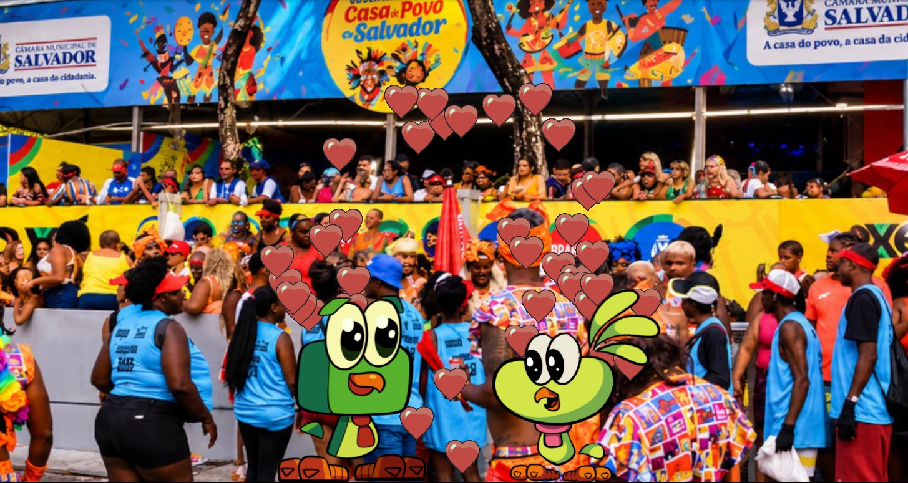

# Projeto Felpudo e Fofura

PLAY UNITY:
https://play.unity.com/en/games/cf80a6be-1ced-4b88-9021-2968dba93497/felpudo-e-fofura-on-carnival

Projeto avaliativo para o curso de Jogos Digitais na Universidade do Estado da Bahia, desenvolvidos por Jonatas Argolo e Isabela Coelho.

### RESUMO:

Nosso projeto foi desenvolvido na Unity 6 utilizando C# e dividido em três cenas. Na primeira, utilizamos scripts para movimentar dois personagens e detectar a aproximação entre eles, acionando um sistema de partículas em formato de corações. Na segunda, implementamos saltos automáticos utilizando Rigidbody2D e efeitos de confetes com Particle System. Na terceira, programamos o movimento de um veículo e utilizamos Coroutines para controlar os intervalos entre as ações. Por fim, utilizamos o SceneManager para realizar as transições automáticas, criando uma animação contínua com início, desenvolvimento e encerramento.

Foi solicitado pelo docente uma pequena história entre os sprites Felpudo e Fofura, de no mínimo 3 cenas para serem exibidas, neste trabalho escolhi por criar um pequeno entre os personagens no Carnaval de Salvador, Bahia, no Circuito Osmar (Campo Grande).

# Primeira Cena
O programa começa com Felpudo e Fofura se encontrando em um dos locais de rota do trio, eles se aproximam um em direção ao outro e ao se tocarem, particulas de coração aparecem na tela.
> Nesta primeira cena foram criadas 3 scripts, respectivamente: MoveFelpudo, MoveFofura e Pararaoencontro.

## MoveFelpudo e MoveFofura

Ambos Scripts foram feitos de forma idêntica:
> Cada um necessitou de 3 variáveis, uma para guardar a referência da posição do outro personagem, uma para modificar sua velocidade, e uma booleana para fazerem parar enquanto nao se encostaram.

```csharp
public Transform forura;
public float velocidade = 1.5f;
private bool podeMover = true;

```
A forma que utilizei para  fazer os personagens se moverem foi utilizando um `Vector3` e o método `MoveTowards()`

```csharp
transform.position = Vector3.MoveTowards(transform.position,destino,
            velocidade * Time.deltaTime // detalhe para esse método que faz a velocidade ficar independente dos quadros por segundo.
        );
```

## Pararaoencontro

Este script faz as verificações do movimento dos personagens e exibi os corações se as condições forem atingidas.
> Foi necessário criar variáveis para o sistema de particulas e a distância entre os personagens.

```csharp
    public ParticleSystem coracoes;
    public Transform forura;
    public float distanciaEncontro = 3f;
    public int quantidadeCoracoes = 20;
    private bool jaEncontraram = false;
```
Para fazer os personagens pararem, utilizamos do método `Parar();` existente nos códigos de movimento dos personagens e para emitir os corações usamos o `Emit();` para determinar quantas partículas serão criadas naquele instante em que eles se encontram.

```csharp
    MoveFelpudo felpudo = GetComponent<MoveFelpudo>();
    if (felpudo != null)
    felpudo.Parar(); // Foi usada a mesma lógica para Fofura

    if (coracoes != null)
    {
      Vector3 posicao =
      (transform.position + forura.position) / 2f;
       posicao.z = 0f;
       posicao.y += 1.5f; // deixar a emissão um pouco acima da cabeça dos personagens
       coracoes.transform.position = posicao;
       coracoes.Emit(quantidadeCoracoes);
       Debug.Log("Coracoes emitidos!");
    }
```
Ao final de todo o processo, seu resultado é para ser vizualizado desta forma:

<p align="center">
  
</p>

# Segunda Cena

Mudando o momento da história, na segunda cena nossos personagens estão curtindo o bloco do Kannário, eles pulam de felicidade ao som da batida e soltam confetes toda vez que isso acontece.

## Pular

Nesta cena foi necessária somente um único script para englobar todo o movimento da cena.
> Nesse Script utilizei variáveis para medir a força e a velocidade dos saltos, para a emissão das particulas e para verificar se nossos personagens estão respeitando as leis da fisica e não saindo voando da tela, existe também um valor booleano para verificar se eles estão em contato com o chão

```csharp
    public float forcaPulo = 5f;
    public float intervaloPulo = 1.2f;
    public ParticleSystem confetes;
    public int qtdConfetes = 3;
    private Rigidbody2D rb; // movimentar os personagens por meio da física do Unity
    private float tempoProximoPulo;
    private bool noChao;
```
O script também controla o intervalo entre os pulos

```csharp
   if (Time.time >= tempoProximoPulo && noChao)
   {
   
    rb.linearVelocity = new Vector2(rb.linearVelocity.x , forcaPulo);
    noChao = false;
    tempoProximoPulo = Time.time + intervaloPulo;
    
   }
```
Verifica se o personagem está tocando o chão evitando que ele pule continuamente enquanto está no ar. Permitindo que ele realize vários saltos na mesma posição


| Característica | `OnCollisionStay2D` | `OnCollisionExit2D` |
|---|---|---|
| Quando executa? | Enquanto a colisão continua | Quando a colisão termina |
| O que verifica? | Se está apoiado no chão | Se deixou de tocar o chão |
| Valor atribuído | `noChao = true` | `noChao = false` |
| Função no projeto | Permitir novos pulos | Impedir pulos no ar |

```csharp
 //Verificação do Pulo
 void OnCollisionStay2D(Collision2D colisao) // verifica se o personagem entrou em contato com o objeto chao
    {
        if (colisao.gameObject.name == "chao")
        {
            foreach (ContactPoint2D contato in colisao.contacts)
            {
                if (contato.normal.y > 0.5f)
                {
                    noChao = true;
                    break;
                }
            }
        }
    }

    void OnCollisionExit2D(Collision2D colisao) // verifica se o personagem deixou de estar em contato com o objeto chao
    {
        if (colisao.gameObject.name == "chao")
        {
            noChao = false;
        }
    }
```
Para emitir os confetes, usamos uma lógica parecida com a usada para os corações na primeira cena

```csharp
   // Emitir confetes apenas quando pular
   if (confetes != null && qtdConfetes > 0)
   {
     confetes.transform.position = transform.position + Vector3.up * 0.8f;
     confetes.Emit(qtdConfetes);
   }
```
Ao final de todo o processo, seu resultado é para ser vizualizado desta forma:

<p align="center">
  
</p>

# Terceira Cena

Para finalizar nossa história, Felpudo e Fofura estão voltando para casa, eles estão esperando um uber, o carro vem em direção a eles, da direita a esquerda, para e espera eles embarcarem, e depois vai embora pela esquerda e a história termina com uma tela preta com um texto escrito "FIM".

## MoveUber e TransicaoCena

Para o script do MoveUber, que engloba 90% do código, utilizei  de variáveis para acompanhar a velocidade e posição do sprite do carro, para desabilitar e habilitar os personagens para dar a ideia de que embarcaram no uber, o tempo que ele levaria para os movimentos acontecerem e valores booleanos para verificar se o carro completou seu trajeto

```csharp
    public float velocidade = 3f;
    public float posicaoParadaX = 0f;

    public GameObject felpudo;
    public GameObject forura;

    public float tempoParaEntrar = 2f;
    public float tempoParaSair = 1f;
    public float posicaoFinalX = -12f;

    public GameObject telaFinal;

    private bool chegou = false;
    private bool indoEmbora = false;
    private bool terminou = false;
```
Para toda parte da lógica de movimento da cena, englobei dentro de dois `if();` as condições para seu inicio de trajeto ate a parada para pegar os personagens e para se deslocar até o lado esquerdo e encerrar a história.

```csharp
if (!chegou)
        {
            Vector3 posicao = transform.position;

            posicao.x = Mathf.MoveTowards(
                posicao.x,
                posicaoParadaX,
                velocidade * Time.deltaTime
            );

            transform.position = posicao;

            if (Mathf.Abs(transform.position.x - posicaoParadaX) < 0.01f) // Calcula a distancia da posição do carro em movimento em relação ao seu destino e verifica se ele será menos que 0.01 como forma de tolerância
            {
                chegou = true;
                StartCoroutine(EntrarNoUber()); //Permite executar a lógica do metodo com pausas definidas dentro dele (tive que pesquisar para saber essa parte)
            }
```
### EntrarNoUber

Esse método é executado quando o carro chega ao destino desejado de parada, ele simula o embarque dos personagens e finaliza o processo para continuar o final do trajeto

```csharp
IEnumerator EntrarNoUber()
    {
        Debug.Log("O Uber chegou!");

        yield return new WaitForSeconds(tempoParaEntrar); // Para o carro
            // Desativa os personagens para dar a impressão de que embarcaram
        if (felpudo != null)
            felpudo.SetActive(false);

        if (forura != null)
            forura.SetActive(false);

        Debug.Log("Felpudo e Forura entraram no Uber!");

        yield return new WaitForSeconds(tempoParaSair);
            // finaliza o processo e da continuidade para o proximo metodo
        indoEmbora = true;
    }
```
Após entrarem no carro, o carro da continuidade ao trajeto com um novo `if();`

```csharp
else if (indoEmbora && !terminou) //Inicia o trajeto final (Uber começa a ir embora porém n saiu da tela ainda)
        {
            Vector3 posicao = transform.position;

            posicao.x = Mathf.MoveTowards(
                posicao.x,
                posicaoFinalX,
                velocidade * Time.deltaTime
            );

            transform.position = posicao;

            if (Mathf.Abs(transform.position.x - posicaoFinalX) < 0.01f)
            {
                terminou = true;
                indoEmbora = false;

                if (telaFinal != null) // Mostra a tela final com o texto
                    telaFinal.SetActive(true);

                Debug.Log("Fim da historia!");
            }
        }
```
Assim encerrando toda a história dos personagens!!

Ao final de todo o processo, seu resultado é para ser vizualizado desta forma (ou algo parecido):

<p align="center">
  
</p>
